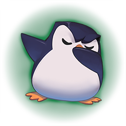
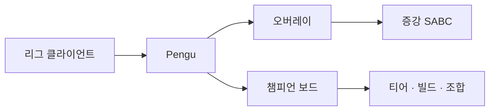

<p align="center">
  
</p>

<h1 align="center">Pengu</h1>

<p align="center">
  <b>고르는 그 순간, 등급이 보인다.</b><br/>
  증강 칼바람을 위한 Windows 데스크톱 오버레이
</p>

<p align="center">
  
</p>

<p align="center">
  
  
  
  
</p>

<p align="center">
  
  
  
  
  &nbsp;
  
  
  
  
</p>

---

## 왜 Pengu인가

증강 선택창이 뜨면 고민할 시간이 거의 없습니다. Pengu는 그 위에 **등급만** 얹어 줍니다. 승률 숫자는 게임에 띄우지 않고, 앱 안에서 챔피언·빌드·조합을 따로 봅니다.

<table>
  <tr>
    <td align="center" width="25%">
      <h3>오버레이</h3>
      제시된 증강에<br/>S · A · B · C
    </td>
    <td align="center" width="25%">
      <h3>챔피언 보드</h3>
      티어 1~4, 초성 검색,<br/>스킬 · 코어 · 조합
    </td>
    <td align="center" width="25%">
      <h3>클릭 통과</h3>
      게임 클릭을<br/>가리지 않습니다
    </td>
    <td align="center" width="25%">
      <h3>다크 / 라이트</h3>
      설정 톱니바퀴에서<br/>바로 전환
    </td>
  </tr>
</table>

## 인게임

게임이 선택지를 내밀면, 카드 옆에 등급 마크가 붙습니다.

- 증강은 **S / A / B / C**
- 챔피언은 **1 / 2 / 3 / 4**
- 최상위 등급만 천천히 숨 쉬듯 빛납니다
- 오버레이는 항상 위, 마우스 이벤트는 아래로

## 앱 안에서

왼쪽은 전체 챔피언 리스트, 오른쪽은 상세입니다.

| 보드 | 상세 |
| :---: | :---: |
| `# / 챔피언 / 티어` 한 줄 | 초상화 안에 티어 숫자 |
| 한글 · 영어 · 초성 검색 | QWE 스킬 순서 + 소환사 주문 |
| 원래 순위 유지 | 순위 · 승률 · 픽률 |
| | 실버 / 골드 / 프리즘 증강 |
| | 코어 아이템 (신발 제외) |
| | 상위 증강 조합 + 설명 툴팁 |

## 흐름



1. 앱을 켜 두면 클라이언트를 기다립니다.
2. 증강 칼바람이 시작되면 오버레이가 켜집니다.
3. 선택지가 나오면 등급만 보여 줍니다.

## 시작하기

로컬 SQLite 수집기는 별도 명령으로 실행합니다. [독립 수집기 사용법](docs/collector.md)

Windows, Node.js 20 이상이 필요합니다.

```bash
npm install
npm start
```

테스트와 타입 검사:

```bash
npm test
npm run typecheck
```

## 스택

<p align="center">

| 층 | 역할 |
| :---: | :--- |
| `presentation` | Electron 창, 오버레이, 설정 UI |
| `application` | 동기화, 등급 조회, 상세 조합 |
| `infrastructure` | 클라이언트 연동, 캐시, 아이콘 |
| `domain` | 등급 · 챔피언 · 검색 규칙 |

</p>

아이콘 · 폰트 · 설명은 앱에 같이 들어 있습니다. 인터넷이 잠깐 없어도 보드는 돌아갑니다.
